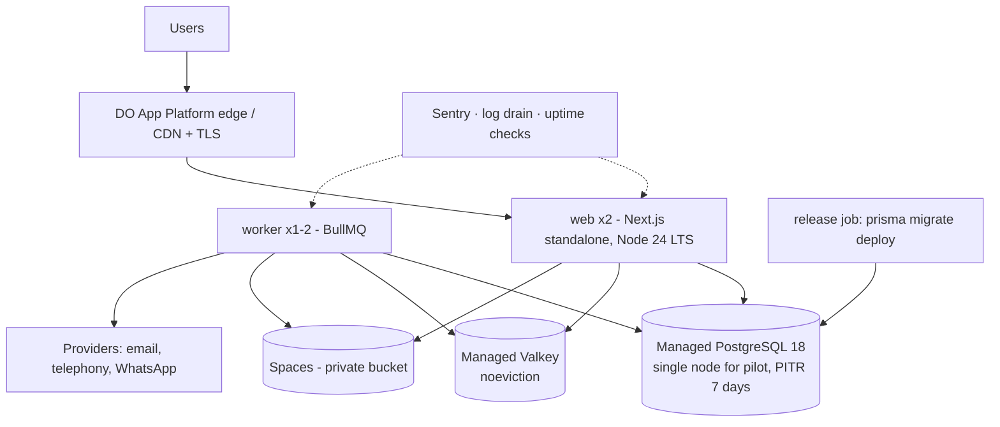

# Deployment and Operations

> Status: Phase 0 draft · Decision: [ADR-0007](adr/ADR-0007-deployment-strategy.md) · Facts verified 2026-10-19.

## 1. Requirements for hosting

1. Indian region for compute, database, cache and storage (latency to Indian users, CERT-In/DPDP posture).
2. **Persistent worker processes** (BullMQ workers must not run inside short-lived request handlers).
3. Managed PostgreSQL 18 with PITR; managed Redis-compatible store; S3-compatible private storage.
4. Simple enough for a small team: no Kubernetes before it's needed.
5. Predictable cost at pilot scale.

## 2. Options compared

| Option | India region | Persistent workers | Managed PG / Redis / S3 in-region | Ops complexity | Indicative cost at pilot* | Notes |
|---|---|---|---|---|---|---|
| **A. DigitalOcean BLR1**: App Platform (web + worker components), Managed PostgreSQL 18, Managed Valkey, Spaces | ✅ Bengaluru | ✅ App Platform worker components (persistent behaviour implied, not explicitly documented, so confirm in S1-18/staging) | ✅ all (DO regional availability page) | **Low** | ≈ ₹6,300–7,600/month without DB HA (see §2.1) | PG 15–18 on Standard Edition. **Standby (HA) nodes are being removed from Standard Edition** (new accounts from 15 Oct 2026, all accounts from 30 Nov 2026); HA requires Advanced Edition from $130/node (BLR1 availability of Advanced **UNVERIFIED**). PITR 7 days. `doadmin` has BYPASSRLS, so the app must use its own role |
| **B. AWS ap-south-1 Mumbai** (or ap-south-2 Hyderabad): ECS Fargate, RDS PostgreSQL 18, ElastiCache Valkey, S3, KMS, WAF | ✅ | ✅ Fargate | ✅ RDS PG 18 GA (AWS release notes); ElastiCache Valkey ap-south-1 near-certain but not verified this session | Medium–High | Higher than A (not priced) | Strongest controls and HA options; most ops effort |
| C. Google Cloud asia-south1 Mumbai / asia-south2 Delhi: Cloud Run / GCE, Cloud SQL PG 18 (default version), Memorystore for Valkey | ✅ | ✅ (Cloud Run worker pools/GCE; India availability of worker pools UNVERIFIED) | ✅ Cloud SQL PG 18; Memorystore Valkey listed in both regions | Medium–High | Higher than A (not priced) | Credible alternative to AWS |
| D. Azure Central India (Pune) / South India: Container Apps / App Service, PostgreSQL Flexible Server 18, Azure Managed Redis | ✅ | ✅ | PG 18 supported (regional availability UNVERIFIED); Managed Redis in India regions | High | Not priced | Viable; note some PG 18 limitations listed by Azure |
| E. Akamai/Linode (Mumbai, Chennai), Vultr (Mumbai, Bangalore, Delhi), E2E Networks (Indian provider, INR billing) | ✅ | VMs | Managed PG and Valkey offered; **PG 18 and per-region availability UNVERIFIED** | Medium | Not priced | Possible low-cost options; less mature managed tooling. E2E docs show PG 15 |
| F. Vercel (bom1 functions) + external DB/Redis | Compute ✅ bom1 | Only via Vercel Daemons (public beta; bom1 UNVERIFIED) | ❌ none in-region from Vercel | Medium (split infra) | Medium | Revisit if Daemons go GA in bom1 |
| G. Oracle Cloud Mumbai/Hyderabad | ✅ | VMs/OKE | Managed PostgreSQL up to **PG 17** only (no PG 18 found) | High | — | Not suitable while PG 18 is required |
| H. Railway / Render / Fly.io | ❌ no India region (nearest Singapore) | ✅ | Singapore | Low | Low | Rejected: data and latency outside India |
| I. Self-managed VMs (Docker Compose) | ✅ any | ✅ | Self-managed DB = high risk | High for DB ops | Lowest | Rejected for production DB; acceptable for disposable test environments |

Facts above were verified on 2026-10-19 from provider documentation. Items marked UNVERIFIED must be checked before commitment. Options B–E were **not priced**. The comparison is sufficient to show that DigitalOcean is *not the only* suitable provider. It is the lowest-effort candidate that fits the provisional budget.

### 2.1 Pilot cost estimate (provisional, OD-15)

> **Superseded on 2026-10-20 by the complete estimate in [hosting-cost-estimate.md](hosting-cost-estimate.md).** That estimate includes staging, email, monitoring and the registry, and comes to ₹12,639/month before tax. It also records a pricing finding: DigitalOcean's current docs price a Standard-plan standby node like the primary, which would make DB high availability ≈ ₹2,900/month rather than the Advanced Edition figure below. That must be verified before provisioning.

Assumptions: ₹88/USD (conservative, assumption); list prices from DigitalOcean pricing pages on 2026-10-19; **GST, telephony, WhatsApp, email and other variable costs excluded**.

| Item | Pilot configuration (recommended) | USD/month |
|---|---|---|
| Web | App Platform 2 × 1 GiB scalable containers ($12) | 24 |
| Worker | App Platform 1 × 1 GiB ($12) | 12 |
| PostgreSQL 18 | Standard Edition, **single node 2 GiB** (≈ $30.45), PITR 7 days, PgBouncer pool | 30.45 |
| Valkey | 1 GiB (`noeviction` is the default) | 15 |
| Spaces | 250 GiB + 1 TiB egress | 5 |
| **Total** | | **≈ $86.60 ≈ ₹7,600** (≈ ₹9,000 if 18% GST applies, UNVERIFIED) |

Smallest variant (1 GiB DB, ≈ 22 backend connections): ≈ ₹6,300. **High-availability DB (Advanced Edition primary + standby, $260) brings the total to ≈ ₹27,800, which exceeds the ₹15,000 ceiling.**

Off-site logical backups to a separate Spaces bucket, log storage and monitoring SaaS add a small amount (≤ ₹1,500 estimated). Sentry free/low tier is assumed.

**Pilot recommendation:**
- Use **DigitalOcean BLR1 without database HA**, compensating with 7-day PITR, nightly off-site `pg_dump`, tested restores and a documented RTO.
- This means pilot availability targets assume a single DB node (NFR-020/021 updated).
- Revisit HA (Advanced Edition or another provider) before onboarding a second brokerage or if the pilot requires a higher SLA. That is a budget decision for the business owner.
- **This is an estimate, not a quote.** OD-15 requires confirming it against the actual DigitalOcean bill in the first staging month.

**Move away from DigitalOcean only if justified** by customer requirements (contractual controls, VPC/KMS), reliability needs (HA within budget elsewhere), security/operational needs, or cost. AWS Mumbai and GCP Mumbai are the leading alternatives. **No migration is scheduled.**

## 3. Runtime topology (candidate: Option A, pilot)

- **Environments:** `local` (Docker Compose: Postgres 18.6, Valkey 9.0.6, Mailpit 1.31.5; S3-compatible storage to be chosen in Phase 2 because MinIO images were withdrawn), `preview` (optional, per-PR with seeded DB), `staging` (production-like, anonymised data only), `production`.
- **Release:** CI builds one image per commit → staging deploy → smoke + E2E → manual promotion to production. Migrations run as a pre-deploy job. Web uses rolling deploy with health checks. Workers drain (SIGTERM → `worker.close()`, 30 s grace).
- **Config:** `NEXT_SERVER_ACTIONS_ENCRYPTION_KEY` and `AUTH_SECRET` identical across web instances; `TZ=UTC`; `NODE_ENV=production`.
- **Scheduled work:** BullMQ Job Schedulers inside the worker. No platform cron is required. A health check alerts if the scheduler hasn't fired for 2 intervals.
- **Connection pooling:** the app uses `pg` pools through the Prisma driver adapter, with a pool size per instance computed against the DB connection limit. DigitalOcean provides PgBouncer (transaction mode by default; session/statement also available). The app uses a **transaction-mode pool**, which is compatible with transaction-local `set_config(..., true)` (verified in S1-07/S1-08/S1-18). Migrations use a direct connection. The app role is a dedicated `NOBYPASSRLS` role, **never `doadmin`** (DigitalOcean's admin user has Bypass RLS).

## 4. Monitoring and logging

| Concern | Tooling | Notes |
|---|---|---|
| Errors (web + worker) | Sentry (`@sentry/nextjs` for web, `@sentry/node` for worker); releases + source maps | `sendDefaultPii: false`; beforeSend scrubber using the PII registry. Verify data region/processing terms (Sentry offers US/EU; **no India region known**, so only scrubbed data is sent) |
| Logs | pino JSON → platform log drain → retained ≥ 1 year in an India-region store (e.g. Spaces/S3 bucket with lifecycle, or a log service with India residency) | Request id propagation; redaction paths for PII |
| Metrics | Platform metrics + custom: queue depth/age (BullMQ metrics), job failures, webhook lag, import throughput | Phase 4 dashboard (Grafana Cloud or similar) |
| Uptime | External checker hitting `/api/health` (DB + Redis ping, read-only) | 1-min interval |
| Alerts | Sentry alerts + uptime + DB/queue thresholds (NFR-083) → email/Slack/WhatsApp on-call | On-call rotation documented before pilot |

## 5. Backups and disaster recovery

Pilot posture (no DB standby, see §2.1): provider PITR covers 7 days. A nightly `pg_dump -Fc` to a separate, versioned Spaces bucket with lifecycle rules provides the 35-day daily and 12-month monthly retention in NFR-022. DigitalOcean Valkey has no backups and RDB persistence only, so queue state is treated as reconstructable (below).

See database-design.md §12. Additional: Valkey is treated as **reconstructable**. The outbox and the reminder backfill sweep rebuild queue state from Postgres after a Valkey loss. Object storage uses versioning and, at base workload, cross-region replication (e.g. BLR1 → SGP1 *only for backups*, subject to legal review; otherwise a second Indian region/provider).

**DR runbook (to write in Phase 1):** declare incident → restore DB to point-in-time in a new cluster → repoint secrets → redeploy → replay outbox → verify with smoke tests. Target RTO 4 h at pilot.

## 6. Operational responsibilities

| Task | Frequency | Owner |
|---|---|---|
| Dependency updates (Renovate) | Weekly | Eng |
| Security advisories (Next.js, Prisma, Node) | Continuous; critical patched ≤ 48 h | Eng lead |
| Restore drill | Quarterly | Eng lead |
| Access review (prod, platform admins) | Quarterly | CTO |
| Failed-job review | Daily (pilot) | On-call |
| Cost review | Monthly | CTO |
| Gazette/regulatory check (DPDP, TRAI) | Each phase gate | Product + legal |
