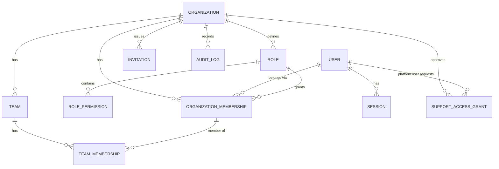
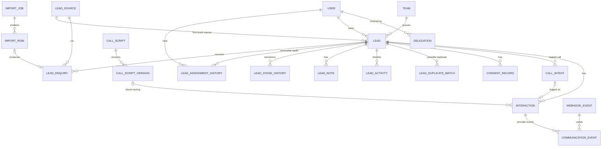
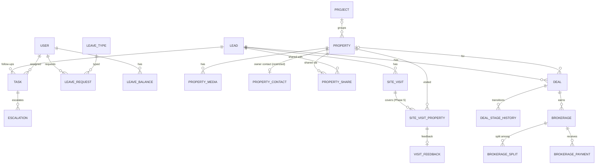

# Conceptual Domain Model and Data Dictionary

> Status: Phase 0 **conceptual** model. This is not a migration. Field lists show the important fields only. Physical types and indexes are finalised per phase in Prisma schema reviews. This file also serves as the **data dictionary** (consolidated to avoid two drifting copies). Physical design rules are in [database-design.md](database-design.md). The full ERD is in [erd.mmd](erd.mmd).

Conventions for every tenant-owned entity, not repeated below: `id uuid (v7)`, `org_id uuid NOT NULL FK → organization`, `created_at`, `updated_at timestamptz`, RLS policy on `org_id`. "Audit" lists which changes produce an `AuditLog` entry beyond the user-facing activity timeline.

## 1. Diagrams

### 1.1 Identity, organisation and teams

### 1.2 Leads, assignment, communication

### 1.3 Work, properties, visits, deals

## 2. Entity catalogue

### 2.1 Identity and organisation

**Organization** (platform-scoped, not RLS-filtered by org)
- Purpose: a tenant (brokerage). Key fields: `name`, `slug` (unique), `status` (`ACTIVE`, `SUSPENDED`, `TERMINATING`, `DELETED`), `plan`, `time_zone` (default `Asia/Kolkata`), `currency` (`INR`), `rera_registration_no` (optional, **OD-10**), `data_region`.
- Lifecycle: Active ↔ Suspended → Terminating (30-day export window) → Deleted. Audit: all status and plan changes (platform audit). Retention: see NFR-054.

**OrgSettings** (1:1 org): masking, session timeouts, SLAs (first-contact hours, overdue grace, escalation thresholds), qualification minimum fields, lost reasons, duplicate policy, maturity windows, working hours/days, holidays. JSONB validated by a versioned Zod schema, plus columns for values used in SQL. Audit: every change (diff).

**User** (global, not per-org)
- Purpose: a person's login identity. Fields: `email` (citext, unique), `name`, `phone_e164`, `email_verified_at`, `platform_role` (`NONE`, `PLATFORM_ADMIN`, `PLATFORM_SUPPORT`), `two_factor_enabled`, `locale`. Auth-library tables (Session, Account/credential, Verification, TwoFactor) hang off User (ADR-0003).
- RLS: users are visible to an org only through memberships. Users read their own row only. Audit: email/password/2FA changes (security events).

**OrganizationMembership**
- Purpose: a user's relationship with an org and their role. Fields: `user_id`, `role_id`, `status` (`INVITED`, `ACTIVE`, `SUSPENDED`, `DEACTIVATED`), `employee_code`, `designation`, `joined_at`, `deactivated_at`, `reports_to_membership_id` (informational, **not** used for scope in Phase 1).
- Unique: `(org_id, user_id)`. Index: `(org_id, status)`. Audit: create, role change, status change.

**Role / RolePermission**
- System roles seeded per org (`is_system = true`, immutable). `RolePermission(role_id, permission_code, scope)` where scope ∈ `OWN|TEAM|ORG|NONE`. Unique `(role_id, permission_code)`. Permission codes are validated against the code catalog at startup (unknown codes → startup error).

**Team / TeamMembership**
- Team: `name`, `description`, `is_active`. Unique `(org_id, lower(name))`.
- TeamMembership: `team_id`, `membership_id`, `team_role` (`MEMBER`, `LEAD`), `started_at`, `ended_at` (history retained; current = `ended_at IS NULL`). Partial unique `(team_id, membership_id) WHERE ended_at IS NULL`. Audit: all changes.

**Invitation**: `email`, `role_id`, `team_id?`, `token_hash`, `expires_at`, `status`, `invited_by`. Token stored hashed.

**SupportAccessGrant**: `platform_user_id`, `reason`, `access_level` (`READ`, `WRITE`), `requested_at`, `approved_by`, `starts_at`, `expires_at` (≤ 72 h), `revoked_at`. Audit: every state change, in both the org and platform audit logs.

### 2.2 Leads

**LeadSource**: org-configurable list (`name`, `channel` category: `PORTAL`, `SOCIAL_ADS`, `WEBSITE`, `REFERRAL`, `WALK_IN`, `CHANNEL_PARTNER`, `COLD`, `OTHER`, `is_active`). Unique `(org_id, lower(name))`. Seeded with "Unknown".

**Lead**: fields as in [lead-lifecycle.md §4](../product/lead-lifecycle.md). Additional system fields: `version int`, `previous_lead_id`, `merged_into_lead_id`, `phone_last10` (for search), `is_test`.
- Unique: partial `(org_id, primary_phone_e164) WHERE stage NOT IN ('WON','LOST') AND deleted_at IS NULL AND merged_into_lead_id IS NULL`.
- Indexes (initial): `(org_id, owner_user_id, stage)`, `(org_id, team_id, stage)`, `(org_id, next_follow_up_at)` WHERE open, `(org_id, created_at DESC, id)`, `(org_id, alternate_phone_e164)`, `(org_id, phone_last10)`, GIN trigram `lower(full_name)`, `(org_id, source_id, created_at)`.
- Ownership semantics: `owner_user_id` = accountable executive; `team_id` = queue/team responsible (always set when owner set: the owner's primary team at assignment time, overridable).
- Audit: owner, stage, contact details, contact status, archive/delete/merge, phone reveal, export inclusion (as bulk entry).
- Retention: while the org is active, unless erased. Erasure = anonymise PII (name → "Erased", phones/email nulled, notes purged), keep milestones for aggregates.

**LeadEnquiry**: `lead_id`, `source_id`, `campaign`, `received_at`, `channel_ref` (portal id, ad id), `raw_payload jsonb` (PII; retained 180 days then trimmed), `import_row_id?`, `external_id?`. Unique `(org_id, source_id, external_id) WHERE external_id IS NOT NULL` (idempotent inbound API).

**LeadAssignmentHistory**: `lead_id`, `user_id?`, `team_id?`, `started_at`, `ended_at?`, `assigned_by` (user or `SYSTEM`), `source` (`MANUAL`, `BULK`, `IMPORT`, `ROUND_ROBIN`, `RULE`, `LEAVE_COVER`, `DEACTIVATION`, `MERGE`), `reason`, `rule_id?`. Constraint: `EXCLUDE USING gist (lead_id WITH =, tstzrange(started_at, ended_at) WITH &&)`. This entity is the basis of KPI attribution. It is immutable except for setting `ended_at` once.

**LeadStageHistory**: `lead_id`, `from_stage`, `to_stage`, `changed_by`, `on_behalf_of?`, `source` (`USER`, `SYSTEM_RULE`, `IMPORT`, `INTEGRATION`), `reason_code?`, `reason_text?`, `related_entity_type/id?`, `occurred_at`. Immutable.

**LeadNote**: `lead_id`, `author_id`, `body` (sanitised text, ≤ 5,000 chars), `edited_until`, `is_pinned`. Immutable after the edit window.

**LeadActivity** (timeline projection): `lead_id`, `type` (`CREATED`, `ENQUIRY`, `ASSIGNED`, `STAGE`, `NOTE`, `INTERACTION`, `TASK`, `VISIT`, `DEAL`, `PROPERTY_SHARED`, `FIELD_CHANGED`…), `actor_id`, `summary jsonb` (small, display-ready), `ref_type/ref_id`, `occurred_at`. Index `(org_id, lead_id, occurred_at DESC)`. Append-only. It is a **projection** for fast timelines; source-of-truth stays in the owning entities. Partition candidate.

**LeadDuplicateMatch**: `lead_id`, `candidate_lead_id`, `match_type` (`PHONE_ALT`, `EMAIL`, `NAME_SIMILAR`), `score`, `status` (`OPEN`, `MERGED`, `DISMISSED`), `resolved_by`. Unique `(lead_id, candidate_lead_id)`.

**CustomFieldDefinition**: `entity` (`LEAD` initially), `key` (immutable slug), `label`, `type`, `options`, `required`, `is_active`, `sort_order`. Unique `(org_id, entity, key)`.

**ConsentRecord**: `lead_id`, `channel` (`CALL`, `WHATSAPP`, `SMS`, `EMAIL`), `purpose` (`SERVICE`, `PROMOTIONAL`), `status` (`GRANTED`, `WITHDRAWN`), `basis` (`FORM_OPT_IN`, `IMPORT_ATTESTATION`, `VERBAL`, `WHATSAPP_OPT_IN`, `INBOUND_ENQUIRY`), `evidence_ref`, `captured_by`, `captured_at`. Append-only (current status = latest per lead/channel/purpose). Retention: lifetime of the lead + 3 years (needs legal review).

### 2.3 Imports

**ImportJob**: `file_object_id`, `file_sha256`, `status` (`UPLOADED`, `PREVIEW_READY`, `MAPPING`, `VALIDATING`, `NEEDS_REVIEW`, `QUEUED`, `PROCESSING`, `CANCELLING`, `CANCELLED`, `COMPLETED`, `COMPLETED_WITH_ERRORS`, `FAILED`), `mapping jsonb`, `options jsonb` (duplicate policy, assignment, default source), `counts jsonb`, `attestation` (text + user + time), `error_report_file_id`, `created_by`, `started_at`, `finished_at`. Index `(org_id, created_at DESC)`, `(org_id, file_sha256)`. Audit: create/start/finish/cancel.

**ImportRow**: `import_job_id`, `row_number`, `status`, `raw jsonb` (retained 30 days, then nulled), `normalized jsonb`, `errors jsonb`, `lead_id?`, `enquiry_id?`. Unique `(import_job_id, row_number)`. Partition/cleanup candidate.

**ImportMappingTemplate**: `name`, `source_id`, `mapping jsonb`.

### 2.4 Assignment

**AssignmentRule** (Phase 4): `name`, `priority`, `conditions jsonb` (validated), `target_type` (`USER`, `TEAM`, `TEAM_ROUND_ROBIN`), `target_id`, `is_active`. **TeamAssignmentState**: `team_id` (PK), `last_assigned_membership_id`, `updated_at`. This is the row-locked round-robin pointer.

**Delegation**: `from_user_id`, `to_user_id`, `starts_at`, `ends_at`, `scope` (`ALL_OWN_LEADS`), `leave_request_id?`, `created_by`, `revoked_at`. Audit: create/revoke/expire.

### 2.5 Communications and scripts

**CallIntent**: `lead_id`, `user_id`, `channel` (`PHONE_NATIVE`, `WHATSAPP_APP`), `created_at`, `interaction_id?` (set when logged), `client_context` (device type). Retained 1 year. Used for K04/K08b only.

**Interaction** (the generalised CallLog): `lead_id`, `user_id`, `on_behalf_of?`, `channel` (`PHONE_NATIVE`, `PHONE_PROVIDER`, `WHATSAPP_APP_CALL`, `WHATSAPP_APP_MESSAGE`, `WHATSAPP_API_CALL`, `WHATSAPP_API_MESSAGE`, `SMS`, `EMAIL`, `IN_PERSON`), `direction` (`OUTBOUND`, `INBOUND`), `source` (`MANUAL`, `PROVIDER`), `status` (`LOGGED`, `INITIATED`, `RINGING`, `IN_PROGRESS`, `COMPLETED`, `FAILED`), `outcome` + `outcome_group`, `occurred_at`, `ended_at?`, `duration_seconds?` (**provider-reported only**; manual estimates go in `manual_duration_minutes` and are never mixed), `notes`, `script_version_id?`, `provider` + `provider_call_id?`, `recording_file_id?`, `error_code?`, `error_message?`, `client_idempotency_key`.
- Unique: `(org_id, provider, provider_call_id) WHERE provider_call_id IS NOT NULL`, `(org_id, user_id, client_idempotency_key)`.
- Index: `(org_id, lead_id, occurred_at DESC)`, `(org_id, user_id, occurred_at)`.
- Retention: 3 years online. Notes are PII.

**CommunicationEvent**: `interaction_id?`, `provider`, `provider_event_id`, `event_type` (normalised: `CALL_INITIATED`, `CALL_RINGING`, `CALL_ANSWERED`, `CALL_COMPLETED`, `CALL_FAILED`, `RECORDING_AVAILABLE`, `MESSAGE_SENT`, `MESSAGE_DELIVERED`, `MESSAGE_READ`, `MESSAGE_FAILED`, `INBOUND_MESSAGE`), `occurred_at` (provider time), `received_at`, `payload_summary jsonb`, `webhook_event_id`. Unique `(provider, provider_event_id)`. Append-only.

**OutboundMessage** (Phase 6): `lead_id`, `user_id`, `channel`, `template_name?`, `template_language?`, `status`, `provider_message_id`, `error_code`, `cost?` (numeric, if reported).

**ProviderReference** (named "CommunicationProviderReference" in the brief): `entity_type`, `entity_id`, `provider`, `external_id`. Maps CRM entities to provider ids (e.g. a user ↔ provider agent id, a lead ↔ WhatsApp `wa_id`). Unique `(org_id, provider, entity_type, external_id)`.

**CallScript**: `name`, `targeting jsonb` (project ids, transaction types, property types, languages, sources), `status` (`DRAFT`, `PUBLISHED`, `ARCHIVED`), `current_version_id`. **CallScriptVersion**: `script_id`, `version_no`, `content jsonb` (sections: opening, questions[], pitch[], objections[{objection, response}], closing), `published_at`, `published_by`. Unique `(script_id, version_no)`. Published versions are immutable.

### 2.6 Daily work

**Task**: `type` (`FOLLOW_UP`, `CALL`, `MEETING`, `DOCUMENT`, `OTHER`), `title`, `description`, `assignee_user_id`, `created_by`, `lead_id?`, `property_id?`, `site_visit_id?`, `due_at`, `end_at?` (meetings), `location?`, `priority` (`LOW`, `NORMAL`, `HIGH`, `URGENT`), `status` (`OPEN`, `DONE`, `CANCELLED`), `completed_at`, `cancel_reason`, `reschedule_count`, `recurrence_rule?`, `version`. Index `(org_id, assignee_user_id, status, due_at)`, `(org_id, lead_id, status)`.
- **Decision:** Meetings are Tasks of type `MEETING` (start/end/location/attendees via `TaskAttendee`). This avoids two calendars. Site visits are separate (their own lifecycle and properties).

**TaskReminder** (optional persisted record): `task_id`, `offset_minutes`, `fire_at`, `sent_at`. Unique `(task_id, offset_minutes, fire_at)`. This is the idempotency anchor for reminders.

**Escalation**: `task_id?` or `lead_id`, `level`, `reason` (`UNCONTACTED_SLA`, `FOLLOW_UP_OVERDUE`), `notified_user_id`, `created_at`, `resolved_at`. Unique `(subject, reason, level)`.

**Notification**: `recipient_user_id`, `type`, `title`, `body`, `link`, `data jsonb`, `read_at`, `channels_sent jsonb`, `digest_key?`. Index `(recipient_user_id, read_at, created_at DESC)`. Retained 90 days.

**LeaveType** (`name`, `paid`, `annual_quota`, `allow_half_day`). **LeaveRequest**: `user_id`, `leave_type_id`, `start_date`, `end_date`, `half_day` (`NONE`, `FIRST`, `SECOND`), `reason`, `status` (`PENDING`, `APPROVED`, `REJECTED`, `WITHDRAWN`, `CANCELLED`), `decided_by`, `decided_at`, `decision_comment`. Exclusion constraint against overlapping APPROVED/PENDING ranges per user. **LeaveBalance**: `user_id`, `leave_type_id`, `year`, `entitled`, `used`, `adjustments` (numeric(5,1)). Computed from approved requests with adjustments ledger (Should). HR fields are visible to HR/Admin/the user only.

### 2.7 Property and sales

**Project** (Should): developer project (`name`, `developer`, `rera_project_no`, `city`, `locality`, `possession_date`).

**Property**: `code` (org-unique human id, e.g. `CBR-P-00123`), `title`, `listing_type` (`SALE`, `RENT`, `LEASE`), `property_type`, `bhk`, `city`, `locality`, `address_line`, `geo` (lat/lng, optional), `price` numeric(15,2), `price_type` (`TOTAL`, `PER_SQFT`, `MONTHLY_RENT`), `maintenance`, `deposit`, `carpet_area_sqft`, `built_up_area_sqft`, `floor`, `facing`, `furnishing`, `amenities text[]`, `status` (`DRAFT`, `AVAILABLE`, `ON_HOLD`, `SOLD`, `RENTED`, `WITHDRAWN`), `responsible_user_id`, `project_id?`, `available_from`, `version`. Index `(org_id, status, city, property_type, price)`, `(org_id, locality)`. Audit: status/price changes.

**PropertyContact** (restricted, separate table so field-level permission is simple): `property_id`, `name`, `phone_e164`, `email`, `relationship` (`OWNER`, `AUTHORISED_AGENT`, `DEVELOPER`). Audit: every read via UI reveal + changes.

**PropertyMedia**: `property_id`, `file_object_id`, `kind` (`IMAGE`, `DOCUMENT`, `FLOOR_PLAN`), `sort_order`, `is_shareable`.

**PropertyShare**: `lead_id`, `property_ids uuid[]` or join table, `token_hash`, `expires_at`, `shared_by`, `channel`, `first_viewed_at`, `view_count`. Public page shows only `is_shareable` media and approved fields.

**PropertyLeadMatch**: **not persisted** initially. Matching runs on demand (query). We persist only when (a) we add match notifications or (b) the scoring cost needs caching. Reason: matches go stale as soon as a lead or property changes.

**SiteVisit** (basic, Phase 4): `lead_id`, `assigned_user_id`, `scheduled_by`, `scheduled_for`, `location_text` / `meeting_point` (free text, no property required), visit-level outcome fields `interest_level`, `objections text[]`, `outcome_notes`, `next_action`, `status` (`SCHEDULED`, `CONFIRMED`, `RESCHEDULED`→ stays one record with `reschedule_count` + history, `CANCELLED`, `NO_SHOW`, `ATTENDED`), `attended_at`, `cancel_reason`, `version`. **SiteVisitProperty** (Phase 5; zero rows allowed for basic visits): `site_visit_id`, `property_id`, `order`. **VisitFeedback**: `site_visit_property_id`, `interest` (`HIGH`, `MEDIUM`, `LOW`, `NONE`), `liked`, `disliked`, `objections text[]`, `notes`. Index `(org_id, assigned_user_id, scheduled_for)`.

**Deal**: `lead_id`, `property_id?`, `owner_user_id`, `status` (`NEGOTIATION`, `BOOKING_PENDING_APPROVAL`, `BOOKED`, `AGREEMENT`, `REGISTERED`, `CANCELLED`, `LOST`), `quoted_value`, `deal_value` numeric(15,2), `booked_at`, `cancelled_at`, `cancel_reason`, `lost_reason`, `version`. Index `(org_id, status, booked_at)`. **DealStageHistory**: from/to/actor/amount/note/time.

**Brokerage** (one per deal per side): `deal_id`, `side` (`BUYER`, `SELLER`, `TENANT`, `LANDLORD`), `basis` (`FIXED`, `PERCENT`), `rate_percent numeric(6,3)?`, `expected_amount numeric(15,2)`, `expected_on`, `gst_applicable bool` (informational), `status` (`EXPECTED`, `PARTIALLY_RECEIVED`, `RECEIVED`, `WRITTEN_OFF`). **BrokerageSplit** (Could): `brokerage_id`, `beneficiary_type` (`USER`, `CHANNEL_PARTNER`), `beneficiary_id`, `share_percent` or `amount`. **BrokeragePayment**: `brokerage_id`, `amount`, `received_on`, `mode`, `reference`, `recorded_by`, `reversed_payment_id?` (reversals are negative entries; payments are never edited). Audit: all money changes.

### 2.8 Governance and operations

**AuditLog**: `org_id?` (null for platform events), `actor_type`, `actor_id`, `on_behalf_of?`, `support_grant_id?`, `action` (dot code), `entity_type`, `entity_id`, `changes jsonb` (PII-redacted), `ip`, `user_agent`, `request_id`, `occurred_at`. Append-only (grant INSERT/SELECT only + trigger blocking UPDATE/DELETE). Index `(org_id, occurred_at DESC)`, `(org_id, entity_type, entity_id)`. Retention 2 years minimum; partition monthly when large.

**OutboxEvent**: `org_id`, `type`, `payload jsonb` (ids only), `created_at`, `published_at?`, `attempts`. Index on unpublished. Purged after 7 days.

**WebhookEvent**: `provider`, `org_id?` (resolved from the endpoint/connection), `connection_id?`, `external_event_id` (or a sha256 of the body when the provider gives no id), `signature_valid bool`, `headers jsonb` (allow-listed), `body jsonb`, `received_at`, `status` (`RECEIVED`, `PROCESSED`, `IGNORED`, `FAILED`), `processed_at`, `error`. Unique `(provider, external_event_id)`. Retention 30 days (body nulled), metadata 180 days.

**IntegrationConnection**: `provider` (`EXOTEL`, `SMARTFLO`, `META_WHATSAPP`, `SMTP`…), `status`, `config jsonb` (non-secret), `secrets_ciphertext` (AES-GCM, key id), `webhook_path_token` (random, used to route inbound webhooks to the org), `created_by`. Audit: create/update/rotate/disable (never log secret values).

**InboundLeadKey** (Phase 6): hashed API key for the inbound lead API; `last_used_at`, `revoked_at`.

**FileObject**: `bucket`, `key`, `size`, `mime`, `sha256`, `purpose`, `owner_user_id`, `scan_status` (`PENDING`, `CLEAN`, `INFECTED`, `SKIPPED`), `deleted_at`.

**ExportJob**: `requested_by`, `type`, `filters jsonb`, `row_count`, `status`, `file_object_id`, `downloaded_at`, `expires_at`. Audit: request + download.

**ScheduledJob**: **not modelled as a table.** BullMQ Job Schedulers hold schedules. Business-level schedules (reminders) are derived from Task/SiteVisit rows, which are the source of truth.

## 3. Entities considered and rejected

| Candidate | Decision |
|---|---|
| Separate `Contact`/`Person` entity across leads | Deferred. The phone-based lead + enquiry + `previous_lead_id` covers the requirements. Revisit if orgs need multi-lead customers (investors buying repeatedly) (**OD-11**) |
| Separate `Meeting` table | Merged into Task (`type = MEETING`) |
| Separate `CallLog` table | Generalised as `Interaction` (all channels, manual + provider) |
| Persisted `PropertyLeadMatch` | On demand (see above) |
| `Permission` table | Permission catalog lives in code. Only `RolePermission` rows are stored |
| `ScheduledJob` table | Not needed (see above) |
