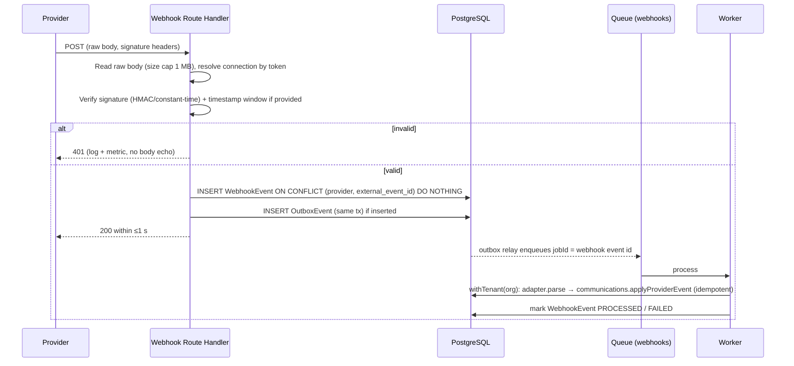

# Integration Strategy (Provider-Independent Design)

> Status: Phase 0 draft. Capability evidence: [calling-and-whatsapp-research.md](calling-and-whatsapp-research.md). Decision: [ADR-0006](adr/ADR-0006-calling-integration-strategy.md).

## 1. Principles

1. **Ports and adapters.** The `communications` module defines ports (TypeScript interfaces). Each provider is an adapter in `src/integrations/<provider>`. Provider SDK types never leave the adapter.
2. **Server-side only.** Credentials live encrypted in `IntegrationConnection` (per org) or in platform secrets. They are never sent to the browser and never in `NEXT_PUBLIC_*`.
3. **Evidence, not inference.** Adapters translate provider facts into internal events. They never fabricate missing outcomes, durations or statuses.
4. **At-least-once in, exactly-once effect.** Every inbound event is deduplicated and every handler is idempotent.
5. **Optional per org.** The CRM is fully functional with no providers connected.

## 2. Internal ports (conceptual)

```ts
interface TelephonyProvider {
  readonly id: ProviderId                       // 'exotel' | 'smartflo' | ...
  capabilities(): TelephonyCapabilities         // { clickToCall, recording, statusEvents: [...], agentFirst }
  startBridgedCall(input: { correlationId: string; agentPhone: E164; customerPhone: E164; callerId?: string; record: boolean }):
    Promise<{ providerCallId: string } | ProviderError>
  verifyWebhook(req: RawRequest, conn: ConnectionSecrets): VerificationResult
  parseWebhook(req: RawRequest): NormalisedCommEvent[]        // pure mapping
  fetchRecording?(ref: RecordingRef): Promise<ReadableStream>
}

interface MessagingProvider {               // WhatsApp Cloud API / BSP, SMS later
  sendTemplate(input: { correlationId; to: E164; template: { name; language; params } }): Promise<{ providerMessageId } | ProviderError>
  sendSessionMessage(...): ...
  verifyWebhook(...); parseWebhook(...): NormalisedCommEvent[]
}

interface WhatsAppCallingProvider { /* Phase 6 PoC-dependent: permission request, connect with SDP, webhooks */ }
```

These are illustrative signatures that fix the shape of the boundary. They are not implementation.

## 3. Normalised event model

| Internal event | Example provider sources | Effect on Interaction |
|---|---|---|
| `CALL_INITIATED` | API response / Exotel `queued` | status INITIATED |
| `CALL_RINGING` | Meta `status: RINGING`, Smartflo ringing trigger | RINGING |
| `CALL_ANSWERED` | Exotel `answered` event; Meta `ACCEPTED` | IN_PROGRESS; outcome group provisional CONNECTED |
| `CALL_COMPLETED` (with `answered: bool`, `durationSec?`, `endedAt`) | Exotel terminal `completed`; Meta `terminate COMPLETED` with duration | COMPLETED; `duration_seconds` = provider value; if not answered → outcome NO_ANSWER **only if the provider states it** (busy/no-answer), else `UNKNOWN_NOT_CONNECTED` |
| `CALL_FAILED` (with provider error code) | Exotel `failed`, Meta `FAILED` | FAILED + error |
| `RECORDING_AVAILABLE` | Exotel `RecordingUrl`, Meta `call_recording_available` | worker downloads into our storage (Meta deletes media after 7 days) → `recording_file_id` |
| `MESSAGE_SENT/DELIVERED/READ/FAILED` | WhatsApp statuses | OutboundMessage status |
| `INBOUND_MESSAGE` | WhatsApp inbound | Interaction INBOUND + opens 24 h window marker |
| `CONSENT_CHANGED` | WhatsApp opt-out ("STOP"), call permission grant/revoke | ConsentRecord |

- **Monotonic state:** an Interaction status never moves backwards (e.g. a late `RINGING` after `COMPLETED` is stored as a CommunicationEvent but ignored for state).
- The user's outcome and notes on a provider interaction go in `outcome`/`notes`. Provider facts (`status`, `duration_seconds`, timestamps) and the raw CommunicationEvents are never overwritten by user input.

## 4. Attribution

| Need | Mechanism |
|---|---|
| Org | Webhook URL contains the connection's random `webhook_path_token` → `IntegrationConnection` → `org_id`. The signature is then verified with that connection's secret |
| Interaction | We create the `Interaction` **before** calling the provider and pass its id as the correlation id (`custom_identifier`, `CustomField`, `biz_opaque_callback_data`). Fallback: `provider_call_id` returned by the API |
| Salesperson | The Interaction's `user_id` (who clicked). For inbound calls: the provider agent id ↔ user via `ProviderReference` |
| Lead | Interaction's `lead_id`. Inbound: phone lookup in org → if exactly one open lead, link; if several or none, an "unmatched inbound" queue for manual linking (never guess) |

## 5. Webhook intake pipeline



- **Signature validation:** Meta `X-Hub-Signature-256` (HMAC-SHA256 of the raw body with the app secret, constant-time compare). Each telephony provider's mechanism (shared secret, basic auth, IP allow-list) is documented per adapter. **Where a provider offers no signature (as documented for Exotel and Smartflo, 2026-10-19), we use the unguessable path token + IP allow-list + HTTPS, and reconcile against the provider's call-details API before trusting money/time-critical data.**
- **Replay protection:** dedup on `(provider, external_event_id)`. If the provider gives no event id, we use `sha256(body)` plus a timestamp tolerance where available (reject events older than 24 h unless arriving via a reconciliation job).
- **Ordering:** handled by the monotonic state rule plus the provider timestamps.
- **Retries:** our processing retries 8× with exponential backoff. Providers' own retries (Meta up to 36 h) are absorbed by dedup.
- **Reconciliation:** a nightly job pulls call-detail records from the provider API for the previous day and compares them with our Interactions. Mismatches create corrective events (`source = RECONCILIATION`) and a report. This catches lost webhooks.
- **Verification handshakes** (Meta `hub.challenge`) are handled by a GET on the same route.

## 6. Outbound calls/messages

1. A Server Action validates permission, contact status, consent (for messaging: opt-in for WhatsApp; for business-initiated WA calls: call permission) and rate limits.
2. In one transaction it creates `Interaction`/`OutboundMessage` with status `PENDING` and an outbox event.
3. The worker calls the provider with an idempotency key where the provider supports it. Otherwise it checks `provider_call_id` before retrying, to avoid double calls. **Calls are never auto-retried after a timeout-without-response**: the status is set to `UNKNOWN` and reconciliation resolves it, because retrying could ring a customer twice.
4. Errors map to an internal taxonomy: `AUTH`, `INVALID_NUMBER`, `DND_BLOCKED`, `NO_PERMISSION`, `RATE_LIMITED`, `PROVIDER_DOWN`, `UNKNOWN`. Retryable: `RATE_LIMITED`, `PROVIDER_DOWN`. Others are terminal.

## 7. Other integrations (reserved)

| Integration | Approach | Phase |
|---|---|---|
| Email (transactional: invites, resets, notifications) | `EmailSender` adapter; Mailpit locally; production provider per §8 (**OD-13**) | 1 |
| Web push | VAPID web push from worker | 4 |
| Inbound lead API (website forms, Zapier-style) | `POST /api/v1/leads` with per-org API key (hashed), idempotent by `external_id` | 6 |
| Meta Lead Ads | Webhook `leadgen` → fetch lead → inbound pipeline | 6 |
| Property portals (99acres, MagicBricks, Housing.com) | **Only via documented partner interfaces or their export files** (import). No scraping. Availability UNCERTAIN, needs business contacts | 6+ |
| Calendar (Google) | OAuth per user, one-way push of meetings/visits | 7 |
| AI (summaries, extraction, prioritisation) | `AiProvider` port. Inputs minimised and PII-redacted where possible. Outputs are suggestions requiring user acceptance. Org opt-in. Processing location/DPDP review before enabling | 7 |
| SMS | DLT-registered sender (entity ID, header, templates) per org. Only if the business needs SMS | 7 (Could) |

## 8. Transactional email (OD-13)

**Decision status:** Mailpit for local development and automated tests is **accepted**. The production provider is **evaluated but not yet selected**. Selection is due before the Phase 1 staging exit.

- **Adapter:** `EmailSender` port (`send({to, template, data, idempotencyKey})`, `parseWebhook()` for bounces/complaints) in `src/integrations/email/*`. Domain modules call `notifications`, never a provider SDK. Switching provider means writing a new adapter plus a DNS change, with no domain changes.
- **Local/test:** Mailpit (SMTP sink with web UI; latest release v1.31.6; https://mailpit.axllent.org/) in Docker Compose. E2E tests read messages through its API (e.g. to click invite and reset links).
- **Evaluation (2026-10-19, pilot volume ~5–20k emails/month):**

| Provider | India data location | Cost at ~10k/month | Domain setup | Bounce/complaint events | Operational notes |
|---|---|---|---|---|---|
| **Amazon SES** (ap-south-1 Mumbai) | ✅ Mumbai region | ≈ $1 ($0.10 per 1k) | SPF, DKIM, custom MAIL FROM, DMARC | SNS/EventBridge (mechanism not re-verified) | Sandbox (200/day, verified recipients) until production access is granted (initial response ≈ 96 h). Needs an AWS account, adding a second cloud |
| **Zoho ZeptoMail** (India DC, zoho.in) | ✅ India DC (Mumbai primary per Zoho) | Credit-based, ≈ ₹150 per 10k (pricing from 1 Jul 2026 UNVERIFIED) | SPF, DKIM, DMARC | Webhooks (UNVERIFIED) | INR billing; simple setup; transactional-only service |
| Postmark | ❌ (US, location UNVERIFIED) | $15 | SPF/DKIM/DMARC | Webhooks | Strong deliverability reputation |
| Resend | ❌ (US/EU/SA/JP regions) | $20 (Pro) | SPF/DKIM/DMARC | Webhooks | Good DX; free tier capped at 100/day |
| Brevo | ❌ (EU) | free tier 300/day; paid from $9 | SPF/DKIM/DMARC | Webhooks | Daily cap risky for invite bursts |
| SendGrid | ❌ (US) | from $19.95 (no permanent free plan) | SPF/DKIM/DMARC | Event Webhook | — |

**Recommendation (pending selection):**
- **Primary:** Amazon SES ap-south-1. It is cheapest, keeps data in India and is mature. File the sandbox-exit request at the start of Phase 1.
- **Alternative:** Zoho ZeptoMail India DC, if a second cloud account is undesirable. It offers INR billing and an India DC.
- Either provider is added to the DPDP sub-processor list. Email bodies carry no lead PII beyond what the recipient is entitled to see (notification links, not data).
- Deliverability is verified in staging with a seed-list test (Gmail, Outlook, Rediffmail, corporate) before selection is finalised.
