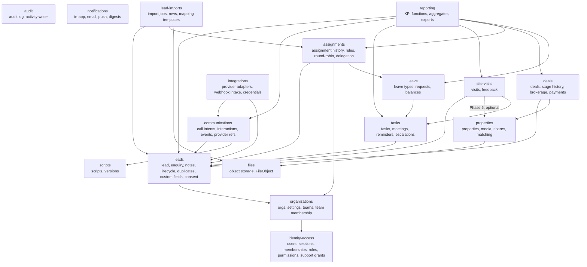

# Module Boundaries

> Status: Phase 0 draft. Each module owns its tables, its domain rules and its public interface (`src/modules/<name>/index.ts`). Other modules may import **only** from that index. This is enforced by ESLint (`no-restricted-imports` / boundaries plugin) from Phase 1.

## 1. Module map

Cross-cutting modules (`identity-access` authorisation API, `audit`, `notifications`, `files`) may be used by all. Arrows show "may call the public API of". **Cycles are forbidden.** When two modules need to react to each other, the lower module publishes a **domain event** (outbox) and the higher module subscribes. Example: `site-visits` changes the lead stage by calling `leads.recordMilestone()`, while `leads` never imports `site-visits`.

## 2. Responsibilities and interfaces

| Module | Owns (tables) | Public commands (examples) | Public queries | Emits events |
|---|---|---|---|---|
| identity-access | User, Session, Account, Verification, OrganizationMembership, Invitation, Role, RolePermission, SupportAccessGrant, PlatformRole | `inviteUser`, `changeRole`, `suspendMember`, `requestSupportAccess` | `getActor`, `authorize`, `scopeFor(ctx, resource)` | `member.deactivated` |
| organizations | Organization, OrgSettings, Team, TeamMembership | `createTeam`, `setTeamLead`, `updateSettings` | `getSettings`, `teamsLedBy` | `team.membership_changed` |
| audit | AuditLog | `record(ctx, entry)` (called within the caller's transaction) | `searchAudit` | — |
| notifications | Notification, NotificationPreference, PushSubscription | `notify(ctx, recipients, template, data)` (writes outbox) | `listForUser`, `unreadCount` | — |
| files | FileObject | `createUploadUrl`, `confirmUpload`, `createDownloadUrl` | — | — |
| leads | Lead, LeadEnquiry, LeadNote, LeadStageHistory, LeadActivity, LeadDuplicateMatch, LeadSource, CustomFieldDefinition, ConsentRecord | `createLead`, `attachEnquiry`, `updateRequirements`, `changeStage`, `recordMilestone`, `merge`, `archive`, `setContactStatus` | `listLeads`, `getLeadWorkspace`, `findDuplicates` | `lead.created`, `lead.stage_changed`, `lead.returning_enquiry` |
| lead-imports | ImportJob, ImportRow, ImportMappingTemplate | `startImport`, `confirmMapping`, `cancelImport` | `getImport`, `listImports` | `import.completed` |
| assignments | LeadAssignmentHistory, AssignmentRule, TeamAssignmentState, Delegation | `assign`, `reassign`, `bulkAssign`, `autoAssign`, `createDelegation` | `assignmentHistory`, `workload` | `lead.assigned` |
| communications | CallIntent, Interaction, CommunicationEvent, OutboundMessage, ProviderReference | `recordCallIntent`, `logInteraction`, `applyProviderEvent`, `startProviderCall` | `timeline`, `unloggedIntents` | `interaction.logged` |
| scripts | CallScript, CallScriptVersion | `createDraft`, `publish`, `archive` | `suggestForLead`, `getVersion` | — |
| tasks | Task, TaskReminder, Escalation | `createTask`, `complete`, `reschedule`, `reassignOpenTasksForLead` | `myDay`, `calendar`, `affectedBy(user, window)` | `task.overdue` |
| leave | LeaveType, LeaveRequest, LeaveBalance | `request`, `approve`, `reject`, `withdraw` | `availability`, `isOnLeave(user, at)` | `leave.approved` |
| properties | Property, PropertyMedia, PropertyContact, PropertyShare, Project | `createProperty`, `share`, `setAvailability` | `match(leadRequirements)`, `getShare(token)` | `property.unavailable` |
| site-visits (basic in Phase 4; property links in Phase 5) | SiteVisit, SiteVisitProperty, VisitFeedback | `schedule`, `confirm`, `reschedule`, `cancel`, `markAttended`, `markNoShow` | `upcoming` | `visit.attended` |
| deals | Deal, DealStageHistory, Brokerage, BrokerageSplit, BrokeragePayment | `openDeal`, `book`, `cancelDeal`, `recordPayment` | `pipeline`, `brokerageOutstanding` | `deal.booked` |
| reporting | KpiDailyAggregate (later), ExportJob | `requestExport` | KPI functions (tile + list mode) | — |
| integrations | IntegrationConnection, WebhookEvent, InboundLeadKey | `connectProvider`, `ingestWebhook` | — | (calls communications/leads commands) |

## 3. Rules

1. **A module writes only its own tables.** It reads other modules' data through their queries. Reporting is the one exception: it has **read-only** SQL access to all tables, because KPI queries need joins. This is documented and reviewed.
2. **Authorisation lives in the module command/query**, which uses `identity-access.authorize` and `scopeFor`. A module never trusts the caller to have checked.
3. **Audit and outbox writes join the caller's transaction.** They are passed `tx`, never a new connection.
4. **No shared "utils" for business logic.** Truly generic helpers (date, money, phone formatting) live in `src/lib`, each in its own small file with tests.
5. **Integrations translate, they don't decide.** A Telephony webhook becomes `communications.applyProviderEvent(normalisedEvent)`. All business decisions happen in communications.
