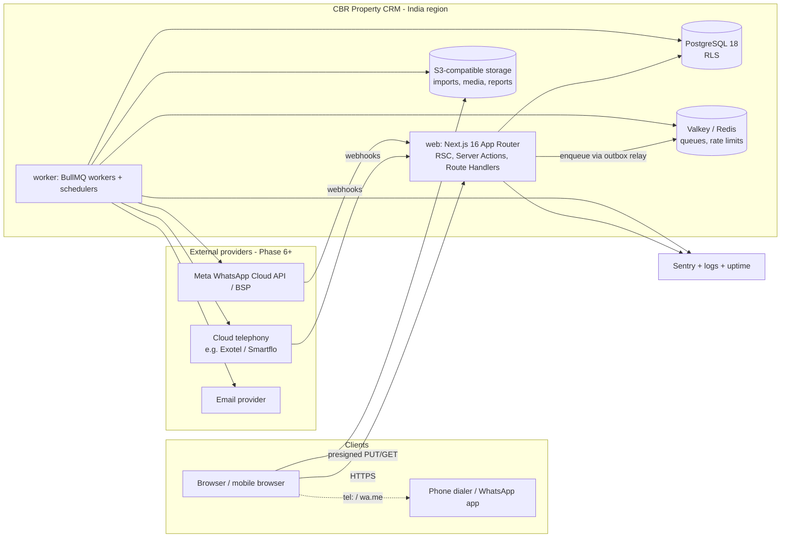

# System Architecture

> Status: Phase 0 draft · Versions verified 2026-10-19 (see [ADR index](adr/)). Related: [module-boundaries.md](module-boundaries.md), [deployment-and-operations.md](deployment-and-operations.md).

## 1. Summary

CBR Property CRM is a **modular monolith**: one TypeScript codebase in one repository, deployed as **two process types** from the same build:

1. **web**: the Next.js App Router application (UI, Server Actions, Route Handlers, webhook receivers).
2. **worker**: a Node.js process running BullMQ workers and job schedulers (imports, reminders, notifications, webhook processing, exports, report aggregation).

They share **PostgreSQL 18** (system of record, with row-level security for tenant isolation), **Redis-compatible storage** (Valkey/Redis for BullMQ queues and rate limiting) and **S3-compatible object storage**.



## 2. Why this shape

- **One deployable codebase** keeps transactions simple. Assignment, stage change, task update and audit happen in one PostgreSQL transaction, with no distributed consistency problems.
- **A separate worker process** keeps long or retryable work (imports, provider calls, reminders) out of request handlers. Serverless request timeouts and instance recycling therefore cannot break it (§5).
- **Module boundaries inside the monolith** (see module-boundaries.md) give us the option to extract a service later, if team size or scaling data justify it (§9).

## 3. Layer responsibilities

| Layer | Lives in | Responsibilities | Must not |
|---|---|---|---|
| **Presentation (Server Components)** | `src/app/**/page.tsx`, `layout.tsx` | Fetch data via module **query functions** (which authorise), render HTML, stream with Suspense | Call Prisma directly; hold business rules |
| **Client Components** | `'use client'` components | Interactivity: forms, drawers, optimistic UI, local drafts, `tel:`/`wa.me` launching | Contain secrets; be the only place a rule is checked |
| **Server Actions** | `src/app/**/actions.ts` or `src/modules/*/actions.ts` | Thin adapters for **first-party UI mutations**: parse input with Zod → call a module command → map the result/error → `revalidatePath/Tag` | Skip auth (they are public POST endpoints); contain business logic beyond orchestration |
| **Route Handlers** | `src/app/api/**/route.ts` | **External** interfaces: provider webhooks, inbound lead API (per-org API key), presigned-URL issuance if not via action, health checks, file download redirects, cron triggers if a platform needs HTTP | Become a generic REST wrapper over every internal read/write |
| **Proxy (`proxy.ts`, formerly middleware)** | `src/proxy.ts` | Coarse concerns only: redirect unauthenticated users to /login, security headers, request id | Act as the authorisation layer (Next.js docs warn matcher changes can silently drop coverage) |
| **Module commands/queries (domain services)** | `src/modules/<module>/application` | Use cases: authorise (`authorize(ctx, permission, resource)`), validate business rules, run the transaction, write audit + outbox | Import another module's internals; know about HTTP |
| **Domain logic** | `src/modules/<module>/domain` | Pure functions/types: lifecycle state machine, duplicate matching, KPI formulas, assignment algorithms | Perform I/O |
| **Data access (repositories)** | `src/modules/<module>/infra/*.repo.ts` | Prisma queries with explicit `select` projections, scope predicates, pagination | Be called from UI code directly |
| **Tenant-scoped DB client** | `src/platform/db` | `withTenant(ctx, tx => …)`: opens an interactive transaction, sets `app.org_id`/`app.user_id` via `set_config(..., true)`, runs the callback | Ever run tenant queries outside it (lint rule) |
| **Background workers** | `src/worker/*`, handlers in `src/modules/*/jobs` | Execute queued jobs through the same module commands, with a system or user actor context | Hold business rules that differ from the web path |
| **Scheduled jobs** | BullMQ Job Schedulers (`upsertJobScheduler`) | Periodic: escalation sweep, reminder backfill, retention purge, KPI aggregation, delegation expiry | Rely on a single in-memory timer |
| **Provider adapters** | `src/integrations/<provider>` | Implement internal ports (`TelephonyProvider`, `MessagingProvider`, `EmailSender`, `ObjectStore`). Map provider payloads ↔ internal events. Verify signatures | Leak provider types outside the adapter |
| **Reporting queries** | `src/modules/reporting` | Named KPI functions (SQL via Prisma `$queryRaw` with tagged templates, or typed SQL) returning tile + drill-down modes | Bypass scope predicates |

### 3.1 Server Actions vs Route Handlers: decision rule

- **Server Action**: the caller is our own React UI, the operation is a mutation, and the response feeds a re-render. Examples: log outcome, assign lead, approve leave.
- **Route Handler**: the caller is *not* our UI (provider, partner, cron, mobile app in future), or the response is a non-React artefact (file stream, redirect to a signed URL, webhook ack), or the endpoint needs custom HTTP semantics (signatures, status codes, idempotency headers).
- **Reads** for pages happen in Server Components via module queries, not via HTTP. Client-side refetching (e.g. polling import progress) uses a small Route Handler or a Server Action returning a DTO. Pick per case, without creating a parallel REST API.

### 3.2 The request context

Every entry point builds a `RequestContext` before calling any module:

```ts
type RequestContext = {
  requestId: string
  actor: { kind: 'user'; userId: string; orgId: string; role: RoleCode; teamIdsLed: string[]; onBehalfOf?: string }
       | { kind: 'system'; orgId: string; reason: string }
       | { kind: 'platform'; userId: string; supportGrantId?: string }
  locale: string; timeZone: string
}
```

(Illustrative only. This is the agreed shape, not implemented code.)

Modules accept a context and never read cookies or headers themselves.

## 4. Transactions and consistency

- **One use case = one database transaction**, opened by the `withTenant` helper. All writes for a use case go inside it: entity, history, activity, audit row, outbox row.
- **Transactional outbox:** side effects (notifications, provider calls, search updates) are written as `OutboxEvent` rows in the same transaction. The worker relays them to BullMQ (polling every 1 s with `FOR UPDATE SKIP LOCKED`, plus a post-commit fast path). Nothing is enqueued for a transaction that rolled back, and nothing is lost if Redis is briefly down.
- **Optimistic concurrency** (`version` column) on Lead, Task, SiteVisit, Deal. The server rejects stale writes with a conflict error that the UI can show.
- **Database-enforced invariants:** unique open lead per phone, non-overlapping assignment spells (exclusion constraint), one membership per (org, user), unique `(provider, external_event_id)` for webhooks, unique import row numbers.
- **Isolation level:** Read Committed by default. Round-robin pointer updates use `SELECT … FOR UPDATE` on the team's assignment-state row.

## 5. Background processing

| Queue | Jobs | Concurrency (start) | Retry policy | Idempotency key |
|---|---|---|---|---|
| `imports` | parse-preview, validate, process-chunk, build-report | 2 per worker | 5 attempts, exponential 10 s base | `import:{jobId}:{phase}:{chunkNo}` + ImportRow status |
| `notifications` | deliver in-app/email/push, digests | 20 | 5, exp 5 s | `notif:{notificationId}:{channel}` |
| `reminders` | task/visit reminders | 20 | 3, exp 5 s | `rem:{taskId}:{offset}:{dueAtEpoch}` + recheck of task state |
| `webhooks` | process stored WebhookEvent | 10 | 8, exp 15 s (keeps well inside providers' retry windows) | `WebhookEvent.id` (unique provider event key) |
| `integrations` | outbound provider calls (send template, create call) | 10 | per provider; non-retryable errors → `UnrecoverableError` | `Interaction.id` / `OutboundMessage.id` |
| `exports` | export generation | 2 | 3 | `export:{exportJobId}` |
| `maintenance` | scheduled: escalation sweep (5 min), delegation expiry (5 min), outbox sweeper (1 min), KPI aggregation (nightly 02:00 IST), retention purge (nightly), orphan file cleanup (daily) | 1–2 | 3 | scheduler id + window |

Rules:
1. Every handler is **idempotent**. It reloads state from the DB, checks whether the effect has already happened, and acts only if not. Job payloads carry ids, not data snapshots.
2. Jobs carry `orgId` and an actor. Handlers run module commands through `withTenant`, so RLS applies to workers too.
3. **Failure:** after the final attempt a job stays in BullMQ's failed set (retained 30 days). A `JobFailure` alert fires. An admin screen (platform) lists failed jobs with a "retry" action. This is our dead-letter equivalent. Business-visible failures (import, export) also set the domain entity to `FAILED` with a reason.
4. Redis is configured with `maxmemory-policy noeviction` and persistence enabled (BullMQ production guidance).
5. **Scheduling:** BullMQ v6 removed legacy repeatable jobs, so we use Job Schedulers. Per-task reminders are delayed jobs. A 5-minute **backfill sweep** re-enqueues any due reminder whose job is missing, for example after a Redis failover. The deterministic job id prevents duplicates.
6. Workers handle SIGTERM gracefully (`worker.close()`). Deployments drain workers before stopping them.

Fallback: BullMQ 6 also offers a PostgreSQL backend with the same API, and pg-boss is a Postgres-only alternative. Either could remove Redis if operating it proves costly. See ADR-0005.

## 6. Object storage

| Object class | Path prefix (per org) | Max size | Allowed types | Access | Retention (default) |
|---|---|---|---|---|---|
| Import uploads | `org/{orgId}/imports/{importId}/source` | 20 MB | `.csv` (text/csv), `.xlsx` (verified by magic bytes, not just extension) | Uploader + admins, presigned GET 5 min | 30 days |
| Rejected-row / export files | `org/{orgId}/exports/{id}` | — | csv/xlsx | Requester only, presigned GET 15 min, single-use token gate | 7 days |
| Property images | `org/{orgId}/properties/{propertyId}/img/{uuid}` | 10 MB | JPEG, PNG, WebP (re-encoded server-side, EXIF stripped) | Org users; public **only** via derived share copies | life of listing |
| Property documents | `.../docs/{uuid}` | 20 MB | PDF | Permission `property.read` | life of listing |
| Call recordings (if enabled) | `org/{orgId}/recordings/{yyyy}/{mm}/{interactionId}` | — | audio (ogg/mp3/wav) | `recording.listen`, streamed via short presigned URL, audited | 90 days |

- Buckets are **private**. Nothing is public-read. Public property share pages are served by the app, which checks the share token, then issues a short-lived presigned URL or proxies a resized derivative.
- Uploads use presigned PUT with `Content-Length` limits. Metadata (`FileObject`: org, owner, key, size, sha256, mime, scan status) lives in Postgres.
- Malware scanning of uploaded documents is a **Should** (ClamAV in the worker, or a provider feature) before files become downloadable by others.
- Server-side encryption at rest is on. Versioning is on for document buckets.
- Binary data never goes into PostgreSQL.

## 7. Caching

- Default: **no application cache**. We rely on Postgres + indexes, and on React `cache()` for per-request deduplication (current user, membership).
- Next.js data caching (`use cache` / Cache Components) is **not used for tenant data** in Phase 1–4, because the cache-key/tenant leakage risk outweighs the benefit. It may be used for static assets and public property share pages.
- Introduce caching only for a measured hotspot, with a documented key (must include `orgId` and scope) and invalidation rule.
- Rate-limit counters and short-lived tokens live in Redis.

## 8. Search

Phase 2 uses PostgreSQL only:
- `phone_e164` B-tree for exact match, plus `phone_last10` for suffix/fragment search,
- `pg_trgm` GIN index on `lower(full_name)` for fuzzy name search,
- `citext` email.

A dedicated search engine is not justified before about 5M leads per org or full-text needs on notes (see §9).

## 9. Growth path (objective triggers)

| Trigger (measured) | Change |
|---|---|
| Dashboard p95 > 2 s after index tuning | Nightly + incremental KPI aggregate tables (planned design, metrics doc §5) |
| Primary DB CPU > 60% sustained, read-heavy | Read replica for reporting and exports (route via a `readOnly` client) |
| Interactions/activities > 500M rows or vacuum pain | Time-based partitioning of `lead_activity`, `interaction`, `audit_log` |
| Webhook bursts > 200/s or provider-specific scaling | Separate `webhook-worker` deployment (same codebase, different queue subscription) |
| Analytics needs beyond OLTP (cross-org benchmarking, ML) | CDC/ETL into a warehouse (e.g. ClickHouse/BigQuery). Never query OLTP for heavy ML |
| Team > ~25 engineers with independent release cadences | Consider extracting the most independent module (likely integrations/communications) as a service |
| One tenant > 20% of load | Dedicated database for that tenant (the `org_id` everywhere makes this feasible) |

None of these are built in Phase 0–5.
