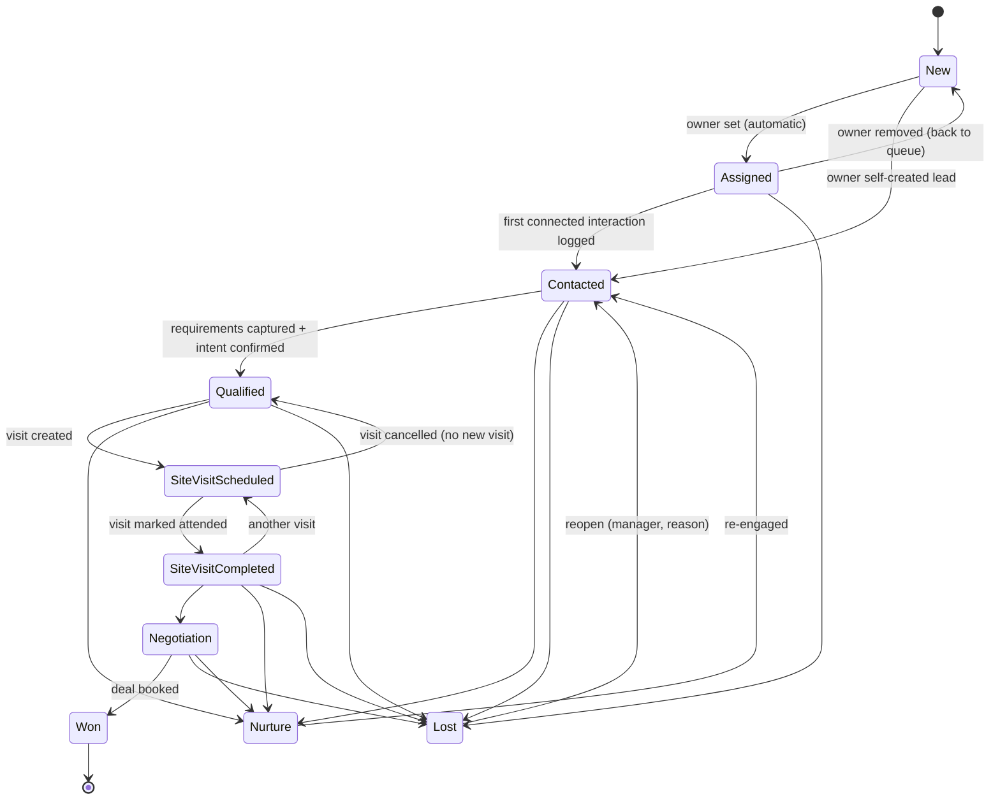

# Lead Data Model and Lifecycle

> Status: Phase 0 draft · Related: [domain-model.md](../architecture/domain-model.md), [metrics-and-kpis.md](metrics-and-kpis.md)

## 1. Concepts that must never be mixed up

| Concept | What it answers | Example values | Changes when… |
|---|---|---|---|
| **Sales stage** (`Lead.stage`) | How far is this customer along the buying journey? | Qualified, Site Visit Scheduled | A salesperson or manager deliberately advances or closes the lead |
| **Interaction outcome** (`Interaction.outcome`) | What happened on *this* contact attempt? | No answer, Busy, Connected – interested | Every call/WhatsApp/meeting is logged |
| **Ownership** (`Lead.owner_user_id`, `Lead.team_id`) | Who is responsible? | Amit, Team West | Assignment or reassignment |
| **Record state** (`Lead.archived_at`, `deleted_at`) | Is the record active in the working set? | Active, Archived | Admin archive/restore; erasure |
| **Contactability** (`Lead.contact_status`) | May we contact them and how? | OK, Do-not-call, Invalid number | Customer request, wrong number, or consent withdrawal |

"No answer" is an outcome. It never moves the stage. Five "No answer" outcomes may trigger a *rule* (for example, move to Nurture or escalate). That is a separate, explicit, logged change.

## 2. Stages

| Stage | Code | Meaning | Entry rule | Required on entry |
|---|---|---|---|---|
| New | `NEW` | Received, no owner | Created without an owner | — |
| Assigned | `ASSIGNED` | Has an owner, no conversation yet | Owner set while stage is New. **System-managed**: users cannot pick it | — |
| Contacted | `CONTACTED` | At least one two-way conversation happened | First interaction with a "connected" outcome (manual or provider), or set manually | — |
| Qualified | `QUALIFIED` | Requirements known and the customer is a genuine prospect | Manual | Minimum requirement set: transaction type, property type, city, budget range (configurable) |
| Site Visit Scheduled | `SITE_VISIT_SCHEDULED` | At least one upcoming visit | **Automatic** when a SiteVisit is created (basic visits from Phase 4). Before Phase 4: manual, with date | Visit date/time |
| Site Visit Completed | `SITE_VISIT_COMPLETED` | Customer has visited at least one property | Automatic when a visit is marked Attended | Visit feedback |
| Negotiation | `NEGOTIATION` | Price/terms discussion on a specific property | Manual | Property (Phase 5+) |
| Won | `WON` | Booking/agreement done | Manual; optionally needs manager approval (org setting) | Deal value; property; expected brokerage (Phase 5+) |
| Lost | `LOST` | Closed without a deal | Manual | **Lost reason** (configurable list) + optional note |
| Nurture | `NURTURE` | Genuine but not ready now | Manual | Nurture until date (creates a follow-up task) |

### 2.1 Transition rules

- Stages may move **forward past steps** (Contacted → Site Visit Scheduled is allowed: qualification is implied, and we record `QUALIFIED` reached at the same time in stage history so funnel metrics remain monotonic).
- Backward moves are allowed only along the paths in the diagram, and each needs a reason.
- `WON` is terminal. Changes after Won (cancelled booking) are made on the **Deal** (status `CANCELLED`). The lead then moves to `LOST` with reason "Booking cancelled", by a manager only.
- Reopening `LOST` requires `lead.reassign` or manager scope plus a reason.
- Every change writes a `LeadStageHistory` row: from, to, actor, reason, timestamp, source (`USER`, `SYSTEM_RULE`, `IMPORT`, `INTEGRATION`), and the related entity (for example, the SiteVisit id).
- **Stage list is fixed in code for the platform.** Orgs may rename stage *labels*, hide Negotiation, and configure lost reasons and qualification fields. They cannot add new stage codes, because KPIs depend on them. Custom sub-statuses can be added as tags (**OD-05**).

### 2.2 "Milestone reached" flags

For funnel metrics we store, on the lead, the first time each milestone was reached: `first_contacted_at`, `qualified_at`, `first_visit_scheduled_at`, `first_visit_completed_at`, `won_at`, `lost_at`. These are set once and never cleared, even if the stage later moves back. Conversion KPIs use these flags, not the current stage (see metrics doc).

## 3. Interaction outcomes

Outcomes are grouped so that KPIs can rely on the group, not on labels.

| Group | Outcome codes | Counts as "connected"? |
|---|---|---|
| `NOT_CONNECTED` | `NO_ANSWER`, `BUSY`, `SWITCHED_OFF`, `NOT_REACHABLE`, `CALL_REJECTED`, `WHATSAPP_NOT_AVAILABLE`, `UNKNOWN_NOT_CONNECTED` (provider says not answered, no reason) | No |
| `INVALID` | `WRONG_NUMBER`, `INVALID_NUMBER` | No (also sets `contact_status = INVALID` after confirmation) |
| `CONNECTED` | `CONNECTED_INTERESTED`, `CONNECTED_CALL_BACK`, `CONNECTED_NOT_INTERESTED`, `CONNECTED_ALREADY_BOUGHT`, `CONNECTED_BROKER` (other agent), `CONNECTED_DO_NOT_CALL` | Yes |
| `OTHER` | `MESSAGE_SENT`, `VOICEMAIL` (rare in India), `MEETING_HELD` | — |

`CONNECTED_DO_NOT_CALL` sets `contact_status = DO_NOT_CONTACT` and records a consent-withdrawal entry.

## 4. Lead fields

**R** = required on create · **O** = optional · **S** = system-managed.

| Field | Type | Req | Notes |
|---|---|---|---|
| `id` | UUIDv7 | S | |
| `org_id` | UUID | S | Tenant key |
| `full_name` | text (≤200) | R* | *Imports may allow blank name with phone; displayed as "Unknown" |
| `primary_phone_e164` | text | R | Normalised E.164 (`+919876543210`). Original string kept in `primary_phone_raw` |
| `alternate_phone_e164` | text | O | |
| `email` | citext | O | |
| `preferred_language` | enum/code | O | ISO 639-1 (`hi`, `mr`, `en`, `kn`, …) |
| `preferred_contact_method` | enum | O | `PHONE`, `WHATSAPP`, `EMAIL`, `ANY` |
| `transaction_type` | enum | O (R for Qualified) | `BUY`, `RENT`, `LEASE_COMMERCIAL`, `SELL`, `LET_OUT` (owner-side enquiries; **OD-06**) |
| `property_type` | enum | O (R for Qualified) | `APARTMENT`, `VILLA`, `PLOT`, `ROW_HOUSE`, `OFFICE`, `SHOP`, `WAREHOUSE`, `OTHER` |
| `bhk_min`, `bhk_max` | smallint | O | 0 = studio/RK |
| `budget_min`, `budget_max` | numeric(15,2) INR | O (R for Qualified) | Monthly rent when `transaction_type` is a rental |
| `preferred_city` | text | O (R for Qualified) | |
| `preferred_localities` | text[] | O | Normalised against an org locality list (Phase 5) |
| `purpose` | enum | O | `SELF_USE`, `INVESTMENT`, `UNKNOWN` |
| `timeline` | enum | O | `IMMEDIATE`, `WITHIN_1M`, `1_3M`, `3_6M`, `6M_PLUS`, `UNKNOWN` |
| `intent` | enum | O | `HOT`, `WARM`, `COLD` (salesperson's judgement) |
| `source_id` | FK LeadSource | R (defaults to "Unknown") | First-touch source |
| `campaign` | text | O | First-touch campaign |
| `owner_user_id` | FK User | O | |
| `team_id` | FK Team | O | |
| `stage` | enum | S/R | See §2 |
| `last_interaction_at`, `last_outcome` | | S | Denormalised for lists |
| `next_follow_up_at` | timestamptz | S | Earliest open follow-up task. Maintained transactionally |
| `contact_status` | enum | S | `OK`, `DO_NOT_CONTACT`, `INVALID` |
| `custom_fields` | jsonb | O | Validated against org `CustomFieldDefinition` (max 30 fields) |
| milestone timestamps | timestamptz | S | §2.2 |
| `created_at`, `updated_at`, `created_by` | | S | |
| `archived_at`, `deleted_at` | | S | |

Notes are a separate entity (`LeadNote`), not a field, so they can be timestamped and attributed.

### 4.1 Custom fields

Org admins can define up to 30 custom fields (text, number, date, single-select, multi-select, boolean). Values live in `Lead.custom_fields` (JSONB) and are validated on the server by a Zod schema built from the definitions. Custom fields are filterable. Indexed filtering on custom fields is a Phase 7 concern. Core reporting never depends on custom fields.

## 5. Enquiries and duplicates

A real customer often enquires several times: a portal today, a Facebook ad next week. We model:

- **Lead**: the working record of one customer's buying journey in one org.
- **LeadEnquiry**: each individual inbound enquiry (source, campaign, received_at, raw payload, import row). A lead has one or more enquiries. The first is the lead's attribution source.

**Duplicate policy (default, configurable per org):**

1. Match key: normalised phone (primary or alternate) against open leads (any stage except `WON`/`LOST`, not deleted) in the same org.
2. Match found → **no new lead**. A `LeadEnquiry` is attached to the existing lead, the owner is notified ("returning enquiry"), and a `LeadActivity` is written.
3. Match on a `WON`/`LOST` lead → a **new lead** is created, linked via `previous_lead_id`. Ownership defaults to the previous owner if they are active (configurable).
4. An **exact email** match with another live lead is flagged as a *possible duplicate* (`LeadDuplicateMatch`, reason `EMAIL`) for manual review. It is never merged automatically. Name similarity alone, and a phone match outside rules 1–3, do **not** create review cases (owner decision, 2026-10-26; see 5.1).
5. Enforced in the database: partial unique index on `(org_id, primary_phone_e164) WHERE stage NOT IN ('WON','LOST') AND deleted_at IS NULL`.
6. A phone match with an **archived** open lead attaches the enquiry to that lead, keeps it archived, and opens a review case (`ARCHIVED_ENQUIRY`) where someone decides to restore it or keep it archived. Archived leads are never restored automatically (M5 decision D2).

### 5.1 Matching rules and rationale (M5, owner decision 2026-10-26)

| Signal | What happens | Why |
|---|---|---|
| Same phone (primary or alternate) as an open lead | No new lead. The enquiry is attached to the existing lead, or the owner is told when the caller cannot see it (rules 1–2) | Phone is the reliable identity of an Indian property buyer, and the database already enforces one open lead per phone. A review case would only repeat what has already happened |
| Same phone as an archived open lead | Enquiry attached, lead stays archived, `ARCHIVED_ENQUIRY` review case (rule 6) | Someone must decide whether the archived lead comes back; restoring silently would undo a deliberate archive |
| Same phone as a `WON`/`LOST` lead | New lead linked by `previous_lead_id` (rule 3) | A returning customer starts a new buying journey |
| Exact same email as another live lead, different phone | `EMAIL` review case (rule 4); nothing merged | An email is personal enough that a match is worth a human look, but the phones differ, so it may be a family member or a shared address: a person decides |
| Similar or identical **name only** | Nothing | Common names (for example "Rahul Sharma") would flood the queue with false matches and push personal names into review lists for no benefit |
| Phone match not covered above | Nothing beyond rules 1–3 | No reliable rule was approved; the review reasons `PHONE_ALT` and `NAME_SIMILAR` exist in the schema but have no producer and are not used |

## 6. Audit of lead changes

Every lead change produces a `LeadActivity` timeline entry (user-facing) and, for sensitive changes, an `AuditLog` entry (governance). A sensitive change is any of: ownership, stage, contact details, contact status, archive/delete, merge, export, or phone reveal. The entry records what changed (field-level diff, with PII fields shown as "changed" in audit diffs rather than values), who, when, why, and through which channel (UI, import, rule, integration).
