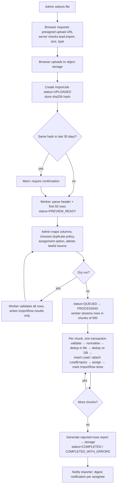
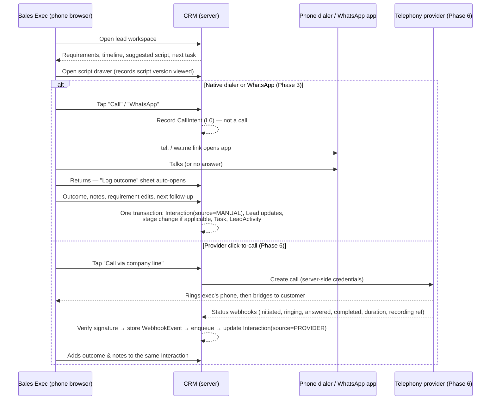
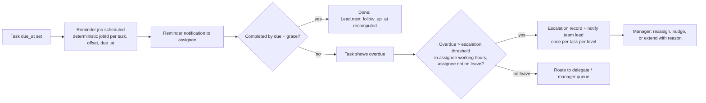
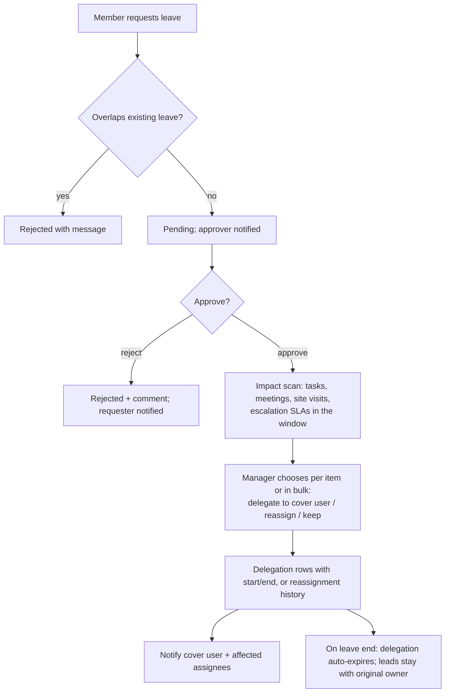

# End-to-End Business Workflows

> Status: Phase 0 draft. Each workflow lists its actors, preconditions, main and alternative paths, failure cases, data written, permissions, audit events, notifications and acceptance criteria. Entity names refer to [domain-model.md](../architecture/domain-model.md).

---

## Workflow A — Import and allocate leads (Phase 2)

**Actors:** Owner/Admin (or Sales Manager if enabled), System worker.
**Preconditions:** Actor has `lead.import`; org is active; the file is ≤ plan limits.

**Main steps**
1. Upload goes direct to storage (presigned PUT, 10 min expiry, content-length limit). The server never streams the file through a request handler.
2. Worker parses with a streaming parser. XLSX files are read from the first visible sheet only (**OD-08**: multi-sheet). Formulas are read as cached values only and never evaluated.
3. Mapping + options saved on `ImportJob`. Lawful-source attestation is stored as a `ConsentRecord` basis on each created lead.
4. Chunked processing. Each `ImportRow` has `(import_job_id, row_number)` unique and a status of `PENDING | IMPORTED | ATTACHED_TO_EXISTING | SKIPPED_DUPLICATE | INVALID | FAILED`.
5. Assignment per option; writes `LeadAssignmentHistory(source=IMPORT)`.
6. Completion: counts, report, notifications.

**Alternative paths**
- *Partial validity:* valid rows commit; invalid rows go to the report. The status is `COMPLETED_WITH_ERRORS`.
- *Same file twice:* hash warning. If the user confirms anyway, row-level dedup turns rows into `ATTACHED_TO_EXISTING` (default policy) or `SKIPPED_DUPLICATE`. No duplicate leads.
- *Interrupted (worker crash, deploy):* the job lock expires and the job is retried. The worker resumes from the first `PENDING` row, because committed chunks already have terminal row statuses. Lead creation within a chunk is protected by the partial unique phone index plus `ImportRow` status in the same transaction.
- *Cancel:* status `CANCELLING`. The worker stops after the current chunk and marks remaining rows `SKIPPED (cancelled)`.
- *Concurrent imports with overlapping phones:* the unique index serialises creation. The losing insert is retried as "attach to existing".

**Failure cases:** corrupt file → `FAILED` with parser error; storage unavailable → retry with backoff (max 5) then `FAILED`; more than 50% invalid rows → job pauses at `NEEDS_REVIEW` after the dry-run-style validation pass (configurable) to protect against a wrong mapping.

**Data written:** FileObject, ImportJob, ImportRow, Lead, LeadEnquiry, LeadAssignmentHistory, LeadActivity, ConsentRecord, Notification, AuditLog.
**Permissions:** `lead.import`; assignment options limited to the actor's scope (a manager can only assign into their teams).
**Audit:** `import.created`, `import.started`, `import.completed|failed|cancelled` (with counts), `lead.assigned (bulk, source=import)`.
**Notifications:** importer (completion); each assignee (one digest: "42 new leads assigned").
**Acceptance:** 100k-row valid file imports in ≤ 10 min at base workload; a killed worker mid-run yields identical final counts to an uninterrupted run; zero duplicate leads in all retry tests.

---

## Workflow B — Salesperson calls a lead (Phase 3; provider path Phase 6)

**Actors:** Sales Executive; System; (later) telephony/WhatsApp provider.
**Preconditions:** Lead in actor's scope; `contact_status = OK` (otherwise a warning is shown and a confirmation required); actor active.

**Alternative paths:** user doesn't return or dismisses the sheet → CallIntent stays "unlogged" and appears in "Unlogged calls" on My Day for 24 h; user logs an outcome without a CallIntent (e.g. called from contacts) → allowed, `source=MANUAL`; WhatsApp not installed → `wa.me` opens the web page, and the user can choose outcome `WHATSAPP_NOT_AVAILABLE`.
**Failure cases:** network loss while logging → form draft kept locally and the submit is retried with an idempotency key (no double interaction); provider API failure → error shown and an `Interaction` with `status=FAILED` + error code is stored; webhook arrives before the API response → reconciled via provider call id.
**Data written:** CallIntent, Interaction, CommunicationEvent (provider), Lead (requirements, `last_interaction_at`, `last_outcome`, milestones), LeadStageHistory, Task, LeadActivity.
**Permissions:** `lead.read`, `interaction.create` in scope; `lead.reveal_phone` implicitly logged when dialling a masked number.
**Audit:** `lead.phone_revealed` (if masking), stage changes; interactions themselves are in the timeline (not the audit log).
**Acceptance:** from lead page to logged outcome in ≤ 3 taps after the call; manual vs provider entries visibly distinguished; no KPI counts L0 as a call.

---

## Workflow C — Follow-up and escalation (Phase 3 basic, Phase 4 full)

**Actors:** Sales Exec, Sales Manager, System scheduler.

**Rules:** reschedule changes `due_at`. The reminder job key includes `due_at`, so stale jobs find the task changed and exit (no-op). Escalation is idempotent via unique `(task_id, level)`. Escalation thresholds count working hours only.
**Data written:** Task, Notification, Escalation, LeadActivity. **Audit:** reassignment by manager.
**Acceptance:** no duplicate reminders under worker restarts or reschedules (tested); escalations never fire for users on approved leave.

---

## Workflow D — Buyer → property → site visit (basic visit: Phase 4 · matching, sharing, property-linked visits: Phase 5)

> In Phase 4, steps 2–3 are skipped and the visit records a free-text location with visit-level feedback. Steps 2–3 and per-property feedback arrive in Phase 5.

1. Exec qualifies the lead (min requirement set present) → stage Qualified.
2. "Suggest properties" runs the match query (status Available, city, type, budget band ±10% configurable, BHK, locality preference) → a ranked list with match reasons.
3. Exec shares 1–5 properties: creates a `PropertyShare` (expiring token link) and opens WhatsApp with a prefilled message containing the link (`wa.me/?text=`). The share is logged on the timeline.
4. Exec schedules a `SiteVisit` (properties, time, meeting point, assignee — may be a field agent) → stage auto `SITE_VISIT_SCHEDULED`; reminders for the exec and assignee; optional customer confirmation message (Phase 6 via WhatsApp template; earlier, manual).
5. Visit day: status Confirmed / Rescheduled (reason, new time, same SiteVisit) / Cancelled (reason) / No-show / Attended.
6. Attended → visit-level outcome (Phase 4) or per-property feedback (Phase 5) + next action required → stage `SITE_VISIT_COMPLETED`.

**Failure/alternatives:** property becomes unavailable before the visit → the visit is flagged and the exec notified; double-booking an assignee → warning; cancelling the only upcoming visit → stage returns to Qualified (logged).
**Permissions:** `property.read`, `property.share_with_lead`, `site_visit.manage`. Owner contact never appears in shares.
**Acceptance:** stage and milestone timestamps update in the same transaction as the visit status change.

---

## Workflow E — Site visit → deal → revenue (Phase 5)

1. After a visit, the exec opens a `Deal` (lead + property, quoted price) → stage Negotiation.
2. Negotiation notes and offers are recorded as `DealStageHistory` entries (amount, counter-offer, note).
3. Booked → `Deal.status = BOOKED`, `deal_value`, `booked_at` → lead stage Won (`won_at`). If the org requires approval: the status is `BOOKING_PENDING_APPROVAL` until a manager approves.
4. Brokerage record created: side, basis (fixed / % of value), `expected_amount`, `expected_on`, split among participants (Could).
5. Payments recorded by Admin (`BrokeragePayment`: amount, date, mode, reference). Status updates automatically.
6. Lost → reason required → lead Lost.
7. Cancellation after booking → deal Cancelled (reason) → lead Lost ("Booking cancelled") by a manager; reports show the cancelled booking.

**Acceptance:** the funnel report reproduces lead → visit → deal → brokerage chains with consistent counts; money is stored as `numeric(15,2)` and sums reconcile to the paisa.

---

## Workflow F — Leave and workload coverage (Phase 4)

**Rules:** delegation grants `own`-scope access to the absent user's leads for the window only. The delegate's actions record `on_behalf_of_user_id`. Round-robin and escalation skip users on approved leave.
**Permissions:** `leave.request` (self); `leave.approve` (team lead for their teams, HR, admin; never self); `delegation.manage` (sales manager/admin). HR sees counts of affected items only.
**Audit:** `leave.approved|rejected`, `delegation.created|expired|revoked`, `lead.reassigned (source=LEAVE_COVER)`.
**Acceptance:** after approval, no affected item is left unresolved without an explicit "keep"; access disappears at delegation end (tested with clock control).

---

## Workflow G — Lead assignment change (Phase 2)

1. Manager selects a lead (or many) → chooses a new owner/team → enters a reason (required for reassignment).
2. Server: checks `lead.reassign` with scope on **both** the current owner's scope and the target user (the manager must lead the target's team, or be admin).
3. Transaction: `UPDATE lead SET owner_user_id=..., version=version+1 WHERE id=... AND version=:expected` (optimistic lock); close the previous `LeadAssignmentHistory` spell (`ended_at`), open a new spell; move open lead tasks to the new owner (default; configurable "leave tasks with previous owner"); write LeadActivity + AuditLog; outbox events for notifications.
4. Notifications: new owner (assigned), previous owner (removed, without lead details if they lose access), manager digest for bulk.
5. Access: the previous owner loses access immediately unless they have another scope route. Their historical interactions remain attributed to them in reports.

**Failure:** version conflict → "This lead was changed by X just now", reload; target user inactive/on leave → blocked/warned.
**Acceptance:** assignment history forms contiguous, non-overlapping spells per lead (DB constraint test: exclusion constraint on `tstzrange(started_at, ended_at)` per lead).

---

## Workflow H — Dashboard reporting (Phase 4)

1. User opens a dashboard. The server resolves the session → org membership → role → scope (own / team ids / org).
2. Filters are validated (Zod), and the date range is converted from the org time zone to UTC bounds.
3. Each KPI function from `reporting/kpis` runs with `(orgId, scope, filters)`. The scope predicate is applied in SQL, and RLS guarantees the org boundary.
4. Results come back with metadata: definition version, sample sizes, maturity share, coverage of provider data.
5. Drill-down calls the same KPI function in "list" mode with pagination, so the counts are identical.
6. Heavy queries run against materialised daily aggregates when enabled. Freshness is shown ("updated 02:00 IST + live today").

**Permissions:** `report.read` with scope. **Audit:** report exports only.
**Acceptance:** tile count = drill-down total for every KPI in the automated test suite; an executive can never obtain team figures by URL manipulation (test).
